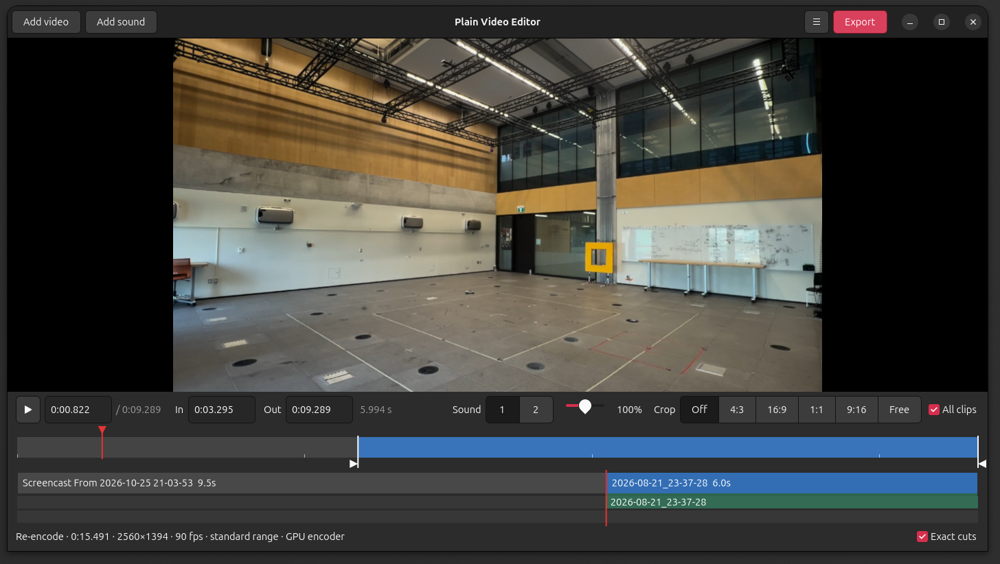

# Plain video editor


A minimal video editor for Linux: trim, crop, join clips into a montage, lay
sound under them, and export. When an edit is only trims and joins of matching
clips it is exported losslessly, without re-encoding.

It is written in Rust, with GTK 4 for the window, mpv for the preview and
ffmpeg for export. There are two programs: `pve-gui`, the window, and `pve`,
the same export from the command line.

## Requirements

- To run: `ffmpeg` and `ffprobe` on the PATH, GTK 4, and mpv's library
  (`sudo apt install ffmpeg libmpv2`).
- To build: a Rust toolchain, and for the window
  `sudo apt install libgtk-4-dev libmpv-dev`. Without root, `. ./dev-env.sh`
  before building does the same job inside `target/` and installs nothing.

## Build and run

```
cargo build --release --workspace
target/release/pve-gui examples/clip1.mp4 examples/clip2.mp4
```

A plain `cargo build --release` leaves the window out and builds only `pve`,
which needs neither GTK nor mpv.

Files can also be added with the **+** at the end of the montage, or dropped
on the window. A video's own sound appears in sound lane 1 under its clip. The
**+** at the end of a sound lane puts a file's sound in that lane, starting at
the play line; a sound file dropped on the window goes into whichever lane is
free there.

To have it in the applications menu with its logo, and under **Open With**
for video files, install it for your user (nothing here needs root):

```
install -Dm755 -t ~/.local/bin target/release/pve-gui target/release/pve
install -Dm644 -t ~/.local/share/applications data/io.github.zaffer.PlainVideoEditor.desktop
install -Dm644 -t ~/.local/share/icons/hicolor/scalable/apps data/io.github.zaffer.PlainVideoEditor.svg
```

No video is kept in this repository: media files are git-ignored everywhere.
Put clips of your own in `examples/` to follow the commands here.

## The window



```
┌──────────────────────────────────────────────────────────────────────┐
│                                                     [⏏ Export]  [☰] │
│                                                                      │
│                              preview                                 │
│                    crop rectangle drawn over it                      │
│                                                                      │
│  Volume ───●─── 100%                  Crop [shapes ...]  ☑ All clips │
│                    ▼ 0:12.400                                        │
│ [▶]  ░░░░░░░│▓▓▓▓▓▓▓▓ 10.000 s ▓▓▓▓▓▓▓│░░░░░░░░░░░░░░ 1:30.000  [⤢]  │
│    0:05.000 ▶                         ◀ 0:15.000                     │
│ [▶]  [0:00.0 clip1      ][0:10.0 clip2            ]             [+]  │
│ [♪]                      [0:10.0 clip2            ]             [+]  │
│ [♪]        [0:07.0 music               ]                        [+]  │
│  0:07.400 / 0:20.000 · Lossless copy · cuts move out +1.7 s  ☐ Exact │
└──────────────────────────────────────────────────────────────────────┘
```

There are four rows, each with a button at its start and one at its end:

| Row | At its start | At its end |
|---|---|---|
| Trim bar: the selected clip's whole file | ▶ play what the bar shows, by itself | ⤢ show only the kept part |
| Montage: the clips in order | ▶ play the finished video | + add video |
| Sound lane 1 | ♪ mute in the preview | + add sound to this lane |
| Sound lane 2 | ♪ mute in the preview | + add sound to this lane |

- **Trim bar.** The play position has a triangle above the bar; the in and out
  points have triangles below it, pointing at their lines. Dragging a cut point
  shows that frame but leaves the play position where it was. Clicking the bar
  itself, away from the cut lines, puts the play position there; the cut points
  move only by their own lines and triangles. Scroll to zoom around the
  pointer; Shift+scroll pans.
- **Times.** Each triangle has its time written beside it. Click a time to type
  over it (`83.5`, `1:23.5`, `1:02:03.25`), Enter to set it, Escape to leave it.
  Inside the bar are the length of the kept part and the length of the file.
- **Two kinds of play.** The ▶ beside the montage (Space) plays the finished
  video from the play line, through every clip and with the sound lanes; at the
  end it starts again from the beginning. The ▶ beside the trim bar
  (Shift+Space) plays what that bar shows by itself: the whole file, past the
  in and out points, to see what lies outside the cut.
- **⤢** makes the kept part fill the trim bar, for fine work on a short cut
  from a long file. Press it again (or turn the wheel) for the whole file. It
  changes what the bar shows, not the clip. While it is on, the ▶ beside the
  bar plays only the kept part.
- **Crop.** Pick a shape; it applies to every clip unless **All clips** is off.
  Drag the rectangle or its corners. **Free** is any shape, for the selected clip.
- **Montage.** Click a clip to select it; drag to reorder. Drag the play line
  (anywhere along its height) to scrub through the whole montage. Every clip
  and sound is labelled with the time at which it starts in the finished
  video, then its name.
- **Clicking a clip or a sound only selects it.** The play line of the finished
  video stays where it is, even when it is in another clip, and the ▶ beside
  the montage plays from it. The line comes to the selected clip when you move
  the play position on the trim bar, or play that bar.
- **Sound.** Every sound is an item in one of the two lanes. Click an item to
  select it; then the trim bar, the times and the volume act on it, Delete
  removes it, and dragging moves it (between lanes too). Items that overlap
  are mixed in the export, whether they share a lane or not.
- **A clip's own sound** sits in lane 1, drawn joined to its clip. While it is
  linked it follows the clip through trims, splits and reordering, and the
  export can still be a lossless copy. Moving or trimming it by itself unlinks
  it: from then on it is an ordinary item that stays where you put it (undo
  links it again).
- **♪** mutes a lane in the preview while editing. It does not change the
  export, which always has every sound shown.
- **Volume** acts on the selected clip or sound. A clip with no sound of its
  own has no volume to set.
- **Bottom line.** Where the play line is in the finished video and how long
  that is, then what Export will do: a lossless copy, and how far the cuts move
  to reach keyframes (shown paler on the trim bar), or a re-encode with the
  output size and the reason. **Exact cuts** forces a re-encode.

| Key | Does |
|---|---|
| Space | play the finished video / pause |
| Shift+Space | play what the trim bar shows, by itself / pause |
| Left / Right | one frame back / forward (Shift: one second) |
| I / O | set the in / out point at the play position |
| S | split the clip at the play position |
| Delete | remove the selected clip or sound item |
| Home / End | go to the in / out point |
| Escape | leave a sound item and go back to the clips |
| Ctrl+Z / Ctrl+Shift+Z | undo / redo |
| Ctrl+O / Ctrl+S / Ctrl+E | add files or open a project / save project / export |

Closing the window never loses an edit: the session is kept and
**☰ → Reopen last session** brings it back. Projects are saved as `.pve` files
(JSON, with media paths relative to the project file).

## What export does

- **Lossless copy** when the edit is only trims and joins of clips with the
  same format, no crop, no volume change and no sound besides the clips' own. Cuts land on
  keyframes: the start moves earlier and the end later, never the other way.
- **Re-encode** otherwise: H.264 in MP4 at visually transparent quality
  (x264, CRF 18). The output is as large as the largest clip after cropping;
  smaller clips are scaled up, and clips of another shape get bars.
- **HDR** is kept (10-bit HEVC) only when every clip is the same kind of HDR;
  otherwise HDR clips are tone-mapped to standard range.
- **NVIDIA GPU**, when present: decoding always uses it (same pictures, sooner);
  the GPU *encoder* is used automatically for outputs larger than 1080p, where
  it saves real time. At equal quality it is 1.3–1.7× faster and about a third
  larger. `--encoder x264|nvenc` overrides this on the command line.

## Command line

```
pve probe examples/clip1.mp4                 # what the planner knows about a file
pve plan  examples/montage.pve               # what an export would do, and why
pve plan  examples/montage.pve --commands    # ...and the ffmpeg commands
pve export examples/montage.pve -o out.mp4
pve export examples/montage.pve -o draft.mp4 --draft      # fast, small
```

`pve` is `target/release/pve`. `--mode auto` (default) is lossless when
possible, `--mode encode` always re-encodes with exact cuts, `--mode copy`
fails rather than re-encode.

`examples/montage.pve` is a project written by hand: ten seconds of each of
two clips cropped to 4:3, with the second clip's sound under the first as
well. It looks for `clip1.mp4` (15 s or longer) and `clip2.mp4` (17 s or
longer, with sound) beside it, and opens in the window too.

In a project file, times are seconds from the start of the media (numbers, or
exact fractions like `"1001/30000"`). Crops are in display pixels
(`{"x","y","w","h"}`), or `{"aspect": "4:3"}` for the largest centred
rectangle. Media paths are relative to the project file.

## Layout

```
Cargo.toml            the workspace
crates/pve-core/      the editor without a screen or a disk
crates/pve-native/    ffprobe and ffmpeg, and the pve command line
crates/pve-gtk/       the pve-gui window
testdata/             plan cases and their expected results
examples/             a project to try; your own clips go here
data/                 the logo and the desktop entry
dev-env.sh            builds the window without the -dev packages installed
```

| Part | Where |
|---|---|
| Exact time | `pve-core/src/time.rs` |
| Project data | `pve-core/src/model.rs` |
| Description of a media file | `pve-core/src/media.rs` |
| Project → export plan (no ffmpeg syntax) | `pve-core/src/planner.rs` |
| Editing operations, undo, timeline | `pve-core/src/session.rs` |
| Reading a file with ffprobe | `pve-native/src/probe.rs` |
| Export plan → ffmpeg commands, and running them | `pve-native/src/ffmpeg.rs` |
| Command line | `pve-native/src/main.rs` |
| Window and its actions | `pve-gtk/src/app.rs` |
| Trim bar, montage and crop drawing and input | `pve-gtk/src/widgets.rs` |
| Their geometry and hit-testing, apart from GTK | `pve-gtk/src/geom.rs` |
| Preview players | `pve-gtk/src/player.rs`, `mpv.rs` |
| Scripted window test | `pve-gtk/src/selftest.rs` |

`pve-core` knows nothing about ffmpeg, mpv, GTK or the filesystem, and also
builds for WebAssembly (`cargo check -p pve-core --target wasm32-unknown-unknown`).

## Tests

```
cargo test                 # core and ffmpeg commands; needs no GTK, ffmpeg or media
cargo test --workspace     # ...and the window's geometry
PVE_SELFTEST=/tmp/out target/release/pve-gui examples/clip1.mp4 examples/clip2.mp4
```

`testdata/cases.json` holds projects and the settings to export them under,
`testdata/media/` describes the two files they use, and `testdata/golden/`
holds the expected plan and ffmpeg commands for each case. After an intended
change, rewrite the expected files and read the diff:
`PVE_UPDATE_GOLDEN=1 cargo test -p pve-native --test cases`.

The last command is the window test. It opens the real window and needs two
clips: the first without sound, the second with. It drives the widgets' own
press, drag and release code with pixel coordinates (it does not send real
pointer events), exports, and writes `/tmp/out.pve`, `/tmp/out.mp4`,
pictures of the bars with a clip and with a sound selected
(`/tmp/out-bars.png`, `/tmp/out-bars-sound.png`) and, when the window is on
screen, a picture of all of it in `/tmp/out-window.png`.

## Known limits

- A lossless join of clips that have sound leaves a seam of about 0.1 s at
  each join; a lossless cut may carry up to a tenth of a second of extra sound
  at its start.
- A lossless copy keeps the picture and the first sound track only; extra
  tracks from the camera (metadata, timecode, thumbnails) are dropped.
- Frame-accurate lossless cutting ("smart cut") is not implemented.
- Lane sound in the preview is played by a second player and can be a few
  hundredths of a second out; the export is exact.
- The preview plays one item per lane at a time. Where two items overlap in
  the same lane, only one of them is heard in the preview; the export mixes
  both.
- Rotated phone clips and variable-frame-rate clips are handled by design but
  have not been tested on real files.

## Licence

MIT; see [LICENSE](LICENSE).
